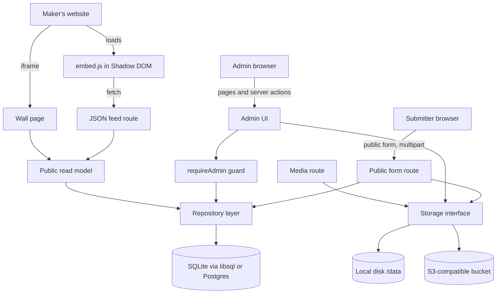
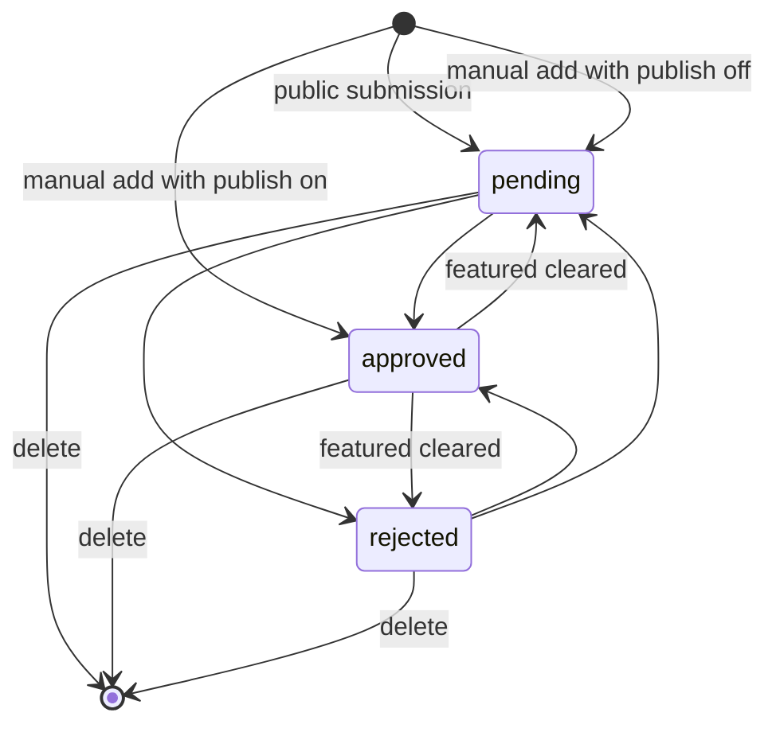
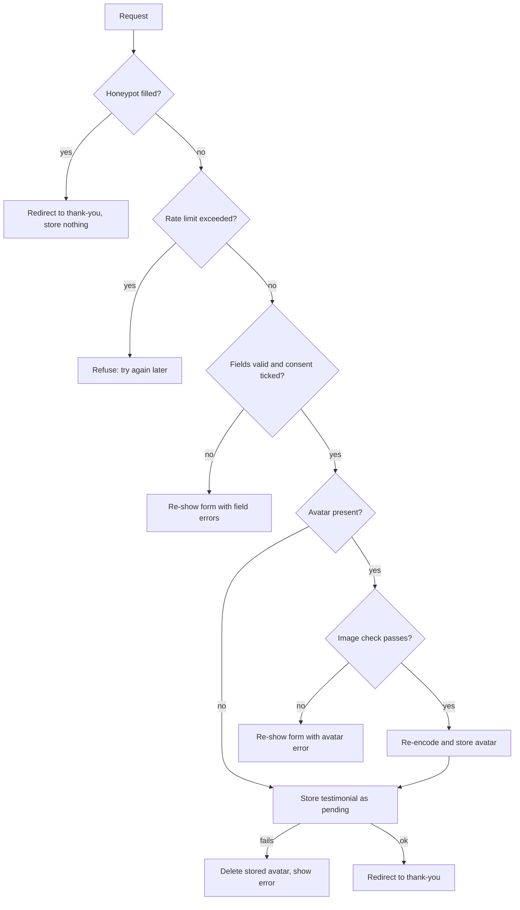

# Kindwords v1 - Plan

## Goal Capsule

- **Objective:** An indie maker can run their own testimonial wall with one `docker compose up`, collect testimonials from customers through a public link, approve them, and show the approved ones on any website by pasting one script tag.
- **Means:** A Next.js app plus a separate framework-free embed script, packaged as one Docker image over SQLite and local disk by default (KTD1, KTD2, KTD8, KTD14).
- **Product authority:** The Product Contract below wins on behavior; Key Technical Decisions win on mechanism within it. Units override neither.
- **Execution profile:** Five phases (see Phased Delivery), each ending in a commit, a code review, and green tests before the next phase starts. The security review runs once the public form and the embed exist (end of Phase 4).
- **Stop conditions:** Stop and ask if a settled decision proves infeasible (for example, dual-dialect Drizzle cannot be made to work), if a non-negotiable (R2, R9, R18, R19, R7, R8) cannot be met as written, or if the widget cannot stay under 15 KB gzipped without dropping a requirement.
- **Open blockers:** None.

---

## Product Contract

Product Contract preservation: changed: R4 gains its deletion rule in R26; R10 gains status changes in R25; added R27 (backend chosen at install) and R28 (setup code), all confirmed by the user during planning; the four deferred questions are resolved (R26, KTD6, KTD8, KTD12) and removed.

### Summary

Kindwords is an open-source, self-hosted testimonial wall for one admin.
Customers submit testimonials through a public form for each product, the admin moderates them in an inbox, and approved testimonials appear on any website through an embeddable wall, an iframe page, or a public JSON feed.

### Problem Frame

Hosted testimonial tools charge a monthly fee for something an indie maker could own outright: a form, an approval queue, and a widget.
The maker who wants to own their data, or who already runs a VPS, has few self-hosted options, and none established.
Kindwords exists because the author wants to build their own version and make it useful to others; demand beyond that is unproven (see Dependencies / Assumptions).

### Actors

- A1. Admin: the single owner of the instance. Sets it up, manages spaces, moderates testimonials, copies embed code.
- A2. Submitter: a customer who opens a space's public link and leaves a testimonial. Not logged in.
- A3. Site visitor: someone viewing the maker's website where the wall is embedded. Sees only approved testimonials.
- A4. Operator: whoever runs the Docker container (usually the admin). Configures storage and database through environment settings.

### Key Decisions

- **Name: Kindwords.** No existing testimonial product uses it, and `kindwords` is free on npm. An unrelated indie game, *Kind Words*, shares the name, so the name won't be unique in search. (session-settled: user-directed — chosen over Laurelwall and Saidso: warm, plain, and says what it holds)
- **SQLite and local disk by default; Postgres and S3-compatible storage optional through environment settings.** Governs R21, R22. (session-settled: user-directed — chosen over deferring Postgres and S3 to the roadmap: operators with existing infrastructure can use it, accepting a doubled database and storage path to build and test)
- **Masonry is the only v1 layout; CSV import waits.** Governs R14. (session-settled: user-directed — chosen over shipping carousel and CSV import in v1: cuts swipe/keyboard/motion work and column-mapping validation from v1)
- **Consent is required to submit.** Everything in the inbox is publishable, so moderation stays a single approve-or-not decision. Governs R6. (session-settled: user-directed — chosen over accepting non-consented submissions as private feedback)
- **Admin edits keep the original text, with no public "edited" label.** Typo fixes don't make a testimonial look suspicious, and the original stays available as an audit trail. Governs R11. (session-settled: user-directed — chosen over a public "edited" label and over overwriting without a record)
- **The iframe fallback doubles as a shareable wall page for each space.** It costs almost nothing beyond the iframe itself and gives makers a link to share. Governs R16. (session-settled: user-approved — proposed in the scope summary, the user confirmed)
- **Featured testimonials sort first, and an embed can be limited to featured only.** Governs R12, R15. (session-settled: user-approved — proposed in the scope summary, the user confirmed)
- **No email in v1, so password recovery is a command run inside the container.** Governs R3. (session-settled: user-approved — proposed in the scope summary, the user confirmed)
- **Any status can move to any other.** The admin can unpublish or reconsider without deleting. Governs R25. (session-settled: user-directed — chosen over "reject is final" and over "all decisions final")
- **Deleting a space deletes everything in it after a typed confirmation.** Governs R26. (session-settled: user-directed — chosen over refusing deletion while the space has testimonials)
- **The database and storage backend are chosen once at install.** A migration tool would double the v1 test surface for a rare operation. Governs R27. (session-settled: user-directed — chosen over shipping a migrate command in v1)
- **First-run setup requires a one-time code from the container logs.** Stops a stranger from claiming a newly exposed instance. Governs R28. (session-settled: user-approved — proposed in the planning scope summary with the extra-step tradeoff, the user confirmed)

### Requirements

**Setup and access**

- R1. On first run with no admin account, the app shows a setup step that creates the single admin account; once an admin exists, the setup step is permanently unavailable.
- R28. The setup step accepts the account only together with a one-time code that the container prints to its logs at startup.
- R2. Every admin page and admin action requires an authenticated admin session; unauthenticated requests are refused or sent to login.
- R3. An operator can reset the admin password with a documented command run inside the container.

**Spaces**

- R4. The admin can create, rename, and delete spaces, one per product, and each space has its own public collection link.
- R26. Deleting a space requires typing its name to confirm, then removes its testimonials and their avatars; embeds that pointed at it show an empty wall.

**Public collection form**

- R5. A space's public form collects name, email, role/company, an optional avatar image, a 1–5 star rating, testimonial text, and a consent checkbox.
- R6. The form cannot be submitted unless the consent checkbox is ticked.
- R7. Spam protection is a honeypot field plus per-client rate limiting on submissions; no third-party CAPTCHA service is used.
- R8. Avatar uploads are accepted only as common image types under a fixed size limit; anything else is rejected with a clear message.
- R9. Testimonial text is plain text: any HTML or markup a submitter enters is stored and shown as literal text, never rendered.

**Moderation**

- R10. New submissions land in a per-space inbox as pending, and the admin can approve, reject, or delete each one.
- R25. The admin can move a testimonial between pending, approved and rejected in any direction; leaving approved clears featured.
- R11. The admin can edit a testimonial's displayed fields; the original submitted text is kept and visible only in the admin view.
- R12. The admin can mark any approved testimonial as featured, and featured testimonials sort first wherever approved testimonials are listed publicly.
- R13. The admin can add a testimonial by hand to any space; it follows the same display rules as a submitted one.

**Display and embed**

- R14. One `<script>` tag renders a space's approved testimonials as a masonry wall in light or dark theme, inside an isolated container so the host site's CSS cannot change its appearance.
- R15. The embed can be limited to featured testimonials only.
- R16. Each space has a public wall page that works both as an iframe embed and as a standalone link to share.
- R17. Each space has a public JSON feed of its approved testimonials.
- R18. Every public surface (script embed, wall page, JSON feed) returns only approved testimonials and never includes a submitter's email or the original pre-edit text.
- R19. All user-submitted text is escaped in every surface it appears: the embed, the wall page, the JSON feed, and the admin UI.

**Deployment and project**

- R20. A fresh clone runs with `docker compose up` and a copied `.env.example`, with data and uploads persisting across container restarts.
- R21. Setting environment values switches the database from the default SQLite to Postgres.
- R22. Setting environment values switches uploads from local disk to an S3-compatible store.
- R27. The README states that the database and storage backend are chosen at install and that v1 has no tool to move data between them.
- R23. The repository ships under the MIT license with a README, a contributing guide, and issue templates, and the README lists the deferred items under Scope Boundaries as the roadmap.
- R24. All names, wording, and visuals are original and borrow no branding or UI from any existing testimonial product.

### Key Flows

- F1. First run
  - **Trigger:** The operator starts the container for the first time.
  - **Actors:** A4, A1
  - **Steps:** The operator runs `docker compose up` and copies the setup code from the logs; the admin opens the app, enters the code with their credentials, and lands in an empty dashboard prompting them to create a space.
  - **Covered by:** R1, R28, R4, R20
- F2. Collect, approve, embed
  - **Trigger:** The admin shares a space's public link.
  - **Actors:** A2, A1, A3
  - **Steps:** The submitter fills in the form and consents; the testimonial arrives as pending; the admin approves it, optionally edits or features it; the admin copies the script tag into their site; site visitors see it on the wall.
  - **Covered by:** R5, R6, R10, R11, R12, R14, R18
- F3. Manual entry
  - **Trigger:** The admin has a testimonial from email or social media.
  - **Actors:** A1
  - **Steps:** The admin adds it by hand to a space and approves it; it appears on the wall like any other.
  - **Covered by:** R13, R14

### Acceptance Examples

- AE1. **Covers R6.** **Given** a submitter has filled in every field, **when** they submit without ticking consent, **then** the form refuses and nothing is stored.
- AE2. **Covers R9, R19.** **Given** a submitter enters `<script>alert(1)</script>` as their testimonial, **when** it is approved, **then** the wall, the wall page, the JSON feed and the admin inbox all show those characters as literal text and no script runs.
- AE3. **Covers R18.** **Given** a space has one pending, one rejected and one approved testimonial, **when** anyone requests the JSON feed, **then** it contains only the approved one, with no email field and no original text.
- AE4. **Covers R11, R18.** **Given** the admin fixed a typo in an approved testimonial, **when** a visitor views the wall, **then** they see the edited text with no "edited" marker, and the admin view still shows the original.
- AE5. **Covers R7.** **Given** a client has hit the submission rate limit, **when** it submits again, **then** the submission is refused with a "try again later" message; **and given** the honeypot field is filled in, the submission is silently discarded.
- AE6. **Covers R1, R28.** **Given** an admin already exists, **when** anyone opens the setup URL, **then** they cannot create a second admin; **and given** no admin exists, a setup attempt with a wrong code is refused.
- AE7. **Covers R12, R15.** **Given** a space has three approved testimonials and one is featured, **when** the default embed loads, **then** the featured one appears first; **when** the embed is set to featured only, **then** only that one appears.
- AE8. **Covers R25.** **Given** a featured, approved testimonial, **when** the admin moves it back to pending, **then** it disappears from every public surface and is no longer featured; **when** it is approved again, it shows unfeatured.
- AE9. **Covers R26.** **Given** a space with testimonials and avatars, **when** the admin deletes it after typing its name, **then** its testimonials and avatar files are gone and an embed still pointing at it renders an empty wall without errors.

### Success Criteria

- The embed script stays under 15 KB gzipped.
- The wall stays readable and unbroken with long names, emoji, right-to-left text, and with 0 or 500 testimonials.
- The public form and the embedded wall pass an accessibility review at WCAG 2.1 AA.
- An end-to-end browser test drives F2 against the real app: submit, approve, and see the testimonial in the embed.

### Scope Boundaries

**Deferred for later** (listed as the README roadmap)

- Carousel layout
- CSV import
- Video testimonials
- Importing from X, G2 or other platforms
- Multiple users and teams
- Email notifications for new submissions, and email-based password reset
- A command to move data between SQLite and Postgres, or between local disk and S3
- A per-space list of websites allowed to load the feed and wall page

**Outside this product's identity**

- Billing, plans or any hosted SaaS tier: Kindwords is self-hosted and free.
- AI summaries or rewriting of testimonials: the wall shows what customers wrote, edited only by the admin.
- A general reviews or survey platform: Kindwords collects and shows testimonials, nothing broader.

**Deferred to Follow-Up Work**

- Auto-height for the iframe embed (the v1 iframe has a fixed height and scrolls inside).
- Running the browser test against Postgres and S3 configurations (CI covers those paths with integration tests only).

### Dependencies / Assumptions

- The author's motivation is to build their own version and share it; demand from other makers is assumed, not evidenced. Testimate and at least one other open-source project already exist, so the README should present Kindwords as a simple, self-owned option rather than the only free one.
- Stated stack for planning: Next.js (App Router) with TypeScript; Drizzle over SQLite with optional Postgres; the embed as a separate framework-free TypeScript bundle; one Docker image with `docker-compose.yml` and `.env.example`; Vitest for logic and Playwright for the end-to-end flow.
- One admin is enough for v1; nothing in v1 needs to support a second user.
- Kindwords runs as a single container process; in-memory rate limits and the setup code rely on that (KTD7, KTD5).

### Sources / Research

- [Testimate](https://gh.r-mj.com/BishalN/testimate): an existing open-source alternative to hosted testimonial tools.
- [Peerlist post on a headless, self-hostable alternative](https://peerlist.io/lordkode/articles/why-i-built-an-opensource-headless-alternative-to-senja-and-): another open-source project in the same space.
- Name check, 2026-11-13: `kindwords` returns 404 on the npm registry; GitHub has about 18 small, unrelated repos with the name.

---

## Planning Contract

### Key Technical Decisions

- KTD1. **Pinned stack: Node 24, Next.js 16.4.x, React 19.3.x, TypeScript ~6.0, drizzle-orm 0.45.x with drizzle-kit 0.31.x, Vitest 5.x, Playwright 1.65.x, esbuild 0.28.x, npm.** These were the current stable versions on 2026-11-13. Stay on Drizzle 0.45 rather than the 1.0 release candidate, and read the 0.45 docs, because 1.0 changes the migration folder layout. Before pinning Next and React, check for security advisories against those exact versions (middleware bypass CVE-2025-29927 and React Server Components CVE-2025-55182 were the recent ones).
- KTD2. **SQLite through libsql (`@libsql/client` with a `file:` URL), Postgres through `pg`, selected by `DATABASE_URL` at startup.** better-sqlite3 transactions are synchronous, which breaks async transaction code shared with Postgres; libsql is async like Postgres. Instantiates the settled backend decision; governs R21.
- KTD3. **Two mirrored Drizzle schemas, one per dialect, behind a repository layer.** Drizzle schemas are dialect-specific (`sqliteTable` vs `pgTable`) and one shared `db` type will not type-check across both. Each dialect has its own drizzle-kit config and migrations folder (`drizzle/sqlite`, `drizzle/pg`). A schema-parity test fails if the two schemas drift in table names, columns, nullability or indexes. Only repository modules touch Drizzle; everything else calls repository functions. Portable column choices: text IDs, epoch-millisecond timestamps (`integer` in SQLite, `bigint` in number mode in Postgres, because Postgres `integer` is 32-bit), and booleans as the dialect's native type. The parity test compares logical types, so the timestamp pair counts as a match. Migrations run at container start before the server listens. Governs R21.
- KTD4. **Each space has a permanent random public ID, separate from its name.** Collection links, the wall page, the JSON feed and embed code all use it. Renaming never breaks an embed, and IDs are never reused after deletion. Supports R4, R26.
- KTD5. **Auth: one admin row with a database constraint allowing only one, scrypt hashing from `node:crypto`, and opaque session tokens stored hashed in the database.** scrypt (N=2^17, r=8, p=1, `maxmem` raised to about 256 MB) needs no native module in Docker. Sessions last 30 days absolute and 7 days idle, in an HttpOnly, SameSite=Lax cookie that is `Secure` only when `PUBLIC_URL` is https, so plain-HTTP LAN installs can log in. The password-reset command revokes all sessions. The setup code (R28) has at least 128 bits of entropy from `crypto.randomBytes`, printed in base32. It is generated in `instrumentation.ts` `register()` at boot only while no admin exists, stored on `globalThis` under a symbol key (so the setup action, which is a separate bundle, reads the same value), and compared in constant time. Creating the admin and checking the one-admin constraint happen in one transaction, so two simultaneous setup submissions yield exactly one admin. Login and setup attempts share one throttle keyed by the KTD7 client-IP resolver: 5 failures per IP per 15 minutes are refused, and failures beyond a global threshold add a growing delay instead of refusing, so an attacker cannot lock the only admin out. Governs R1, R2, R3, R28.
- KTD6. **Auth checks happen in every admin page, server action and route handler, not only in `proxy.ts`.** Next 16 renamed middleware to `proxy.ts`, and a past CVE bypassed middleware entirely. One `requireAdmin()` guard is called at the top of each admin entry point. Server actions get Next's built-in Origin check, which compares `Origin` with `X-Forwarded-Host` or `Host`; `serverActions.allowedOrigins` cannot follow `PUBLIC_URL` because the standalone build bakes `next.config` at build time, so a reverse proxy must forward the original host (documented in U12). Mutating route handlers check `Origin` against `PUBLIC_URL` themselves. Every server-rendered route is dynamic (no build-time prerendering or full-route caching), because database reads are not `fetch` calls and would otherwise be baked in at `next build` or cached. Governs R2.
- KTD7. **Public form: a route handler accepting multipart up to 2.5 MB, checked in a fixed order: body size, rate limit, then parse, honeypot, field validation, image check, store avatar, store testimonial.** A request whose `Content-Length` is missing or over 2.5 MB, or whose streamed body passes it, is refused before parsing. The rate limit needs only the IP and the space, so it runs before the body is read. A filled honeypot gets the same success redirect as a real submission and does not count against the limit. Rate limits are in memory: 5 per IP per 10 minutes per space, plus 50 per space per hour as a backstop. Client IP comes from `X-Forwarded-For` read from the right, honoring `TRUSTED_PROXY_COUNT`. Route handlers cannot see the socket address, and Next fills `X-Forwarded-For` from the socket only when the header is absent, so the app starts through a small custom server (KTD14) that deletes any incoming `X-Forwarded-For` when `TRUSTED_PROXY_COUNT` is 0; Next then fills it from the socket, and a client cannot forge it. If storing the testimonial fails, the stored avatar is deleted. Field limits: name 1–80, role/company up to 120, email up to 254 with a format check, text 10–2000 characters after trimming, and control characters rejected. Line breaks are kept and shown with `white-space: pre-line`. The same limits apply to admin edits and manual add. shortcut: in-memory limits reset on restart and do not work across replicas; upgrade to a database-backed limiter if multi-instance deploys are ever supported. Governs R5, R6, R7.
- KTD8. **Avatars: allow only jpeg, png and webp as detected by sharp from the file contents (never SVG), at most 2 MB and 24 megapixels. Rotate by EXIF, then re-encode to a 256×256 webp with metadata stripped.** Re-encoding removes polyglot files and location data. Avatars are always served by the app at `/media/<key>` with fixed `Content-Type`, `X-Content-Type-Options: nosniff`, a sandbox CSP and `Cross-Origin-Resource-Policy: cross-origin`. The app streams from local disk or S3 behind one storage interface, so the bucket never needs to be public. Governs R8, R22.
- KTD9. **One public read model owns what leaves the server.** A single function maps a stored testimonial to its public shape from an allowlist: display name, role/company, rating, text, avatar URL, featured flag, created date. Email and original text cannot reach it. It returns approved items only, featured first, then newest first. The JSON feed, the wall page and the embed all use it. Governs R12, R15, R17, R18.
- KTD10. **Escaping: React's default escaping in the app, `textContent` only in the widget, and a lint rule that bans `dangerouslySetInnerHTML` and `innerHTML`.** The JSON feed is served as `application/json` with `nosniff`. Testimonial text is stored exactly as submitted (no sanitizing on the way in), so nothing is lost and every output path escapes. Governs R9, R19.
- KTD11. **Widget: a framework-free TypeScript IIFE built by esbuild into `public/embed.js`, rendering into a Shadow DOM with styles applied through `adoptedStyleSheets` and a `<style>` fallback.** Masonry uses CSS columns, with no layout JavaScript. It uses system font stacks because `@font-face` does not work inside a shadow root. Avatars use `loading="lazy"`. The script tag carries `data-space`, `data-theme` (`light`, `dark` or `auto`, default `auto`) and `data-featured`. A CI check fails the build when the gzipped size exceeds 15 KB. Governs R14, R15.
- KTD12. **Public surfaces are open to any website.** The JSON feed sends `Access-Control-Allow-Origin: *` with no credentials and `Cache-Control: public, max-age=30`. The wall page sends `frame-ancestors *` and no `X-Frame-Options`. Every other route sends `frame-ancestors 'none'` and `X-Frame-Options: DENY`. The wall page uses the same `data-theme` options via a query parameter. Governs R16, R17.
- KTD13. **`PUBLIC_URL` is the externally visible origin,** used for embed snippets, share links, absolute avatar URLs, Origin checks and the cookie's `Secure` flag. It falls back to the request origin with a startup warning.
- KTD14. **Docker: a multi-stage build on `node:24-slim` (not Alpine) with Next's standalone output.** The image copies `.next/static`, `public/`, both migrations folders, and a CLI bundle built with esbuild (reset-password and migrate). It runs as the built-in `node` user with `/data` as the only writable volume (SQLite file and local uploads). One `start:standalone` script copies static files and `public/` into the standalone folder, runs migrations, and starts the custom server entry (`server/start.mjs`, which wraps Next's standalone handler per KTD7) instead of the generated `server.js`. The Docker entrypoint and Playwright both use it, so tests run the same startup path as production. Governs R20, R3.
- KTD15. **Tests: Vitest for units and repository integration, Playwright for F2 against the production build.** Repository tests run against a temporary SQLite file always, and against Postgres when `TEST_DATABASE_URL` is set. Storage tests run against local disk always, and against an S3-compatible container when `TEST_S3_ENDPOINT` is set. CI provides both as service containers. Playwright's `webServer` runs the `start:standalone` script (KTD14) on a fresh data directory.

### High-Level Technical Design

Components and where data flows:



Testimonial status (R10, R25, R12):



Featured is a flag that can be set only while approved.

Public form submission order (KTD7):



### Output Structure

```text
.
├── src/
│   ├── app/
│   │   ├── setup/                     first-run setup page
│   │   ├── login/
│   │   ├── admin/                     dashboard, spaces, inbox, edit, manual add
│   │   ├── c/[publicId]/              public collection form + thank-you
│   │   ├── w/[publicId]/              public wall page (iframe + share link)
│   │   ├── api/public/[publicId]/     JSON feed route
│   │   ├── api/submit/[publicId]/     public form submission route
│   │   └── media/[key]/               avatar serving route
│   ├── server/
│   │   ├── config.ts                  env parsing and validation
│   │   ├── db/                        schema.sqlite.ts, schema.pg.ts, client.ts, repositories
│   │   ├── auth/                      password, session, guard, setup code
│   │   ├── storage/                   interface, local disk, S3
│   │   ├── testimonials/              validation, status rules, public read model
│   │   ├── uploads/                   avatar checks and re-encoding
│   │   └── rate-limit.ts
│   ├── components/
│   ├── instrumentation.ts             prints the setup code at boot
│   └── cli/                           reset-password, migrate
├── server/start.mjs                   custom server entry (client-IP hardening)
├── widget/src/                        embed.js source
├── drizzle/sqlite/  drizzle/pg/       generated migrations
├── tests/unit/  tests/integration/  tests/e2e/
├── scripts/                           widget size check
├── Dockerfile  docker-compose.yml  .env.example
└── .github/workflows/ci.yml
```

### Assumptions

- Next 16's `proxy.ts` and server action Origin checks behave as documented for 16.4; U3 verifies the Origin check with a test rather than trusting it.
- Drizzle 0.45 with libsql supports interactive async transactions on SQLite; U2 proves this with a test before other units build on it.
- System font stacks are acceptable for the widget's look.

### Risks

| Risk | Mitigation |
|---|---|
| Dual-dialect schemas drift and a Postgres install breaks silently | Schema-parity test (KTD3) plus the Postgres CI job (KTD15) |
| Rate limiting locks out everyone behind a reverse proxy, or is bypassed by a forged header | `TRUSTED_PROXY_COUNT` defaults to direct-socket mode; README explains setting it behind a proxy (KTD7) |
| A future change leaks email or original text into a public surface | Single public read model with an allowlist and a test asserting the exact key set (KTD9) |
| Widget grows past 15 KB | CI size check (KTD11) |
| Next/React security advisories | Pin patched versions at install (KTD1) |

### Phased Delivery

Each phase ends with a commit, a code review, and green tests.

1. **Foundation:** U1, U2, U3
2. **Spaces and collection:** U5, U4, U6
3. **Moderation:** U7
4. **Public surfaces:** U8, U9, followed by the security review of the public form and the embed
5. **Packaging and release:** U10, U11, U12

---

## Implementation Units

| U-ID | Title | Key files | Depends on |
|---|---|---|---|
| U1 | Project scaffold and config | `package.json`, `src/server/config.ts`, `eslint.config.mjs` | — |
| U2 | Dual-dialect data layer | `src/server/db/*`, `drizzle/*` | U1 |
| U3 | Admin auth, setup and password reset | `src/server/auth/*`, `src/app/setup`, `src/app/login`, `src/cli/reset-password.ts` | U2 |
| U4 | Spaces | `src/app/admin/spaces`, `src/server/db/repositories/spaces.ts` | U3, U5 |
| U5 | Storage and avatar processing | `src/server/storage/*`, `src/server/uploads/avatar.ts`, `src/app/media/[key]` | U1 |
| U6 | Public collection form | `src/app/c/[publicId]`, `src/app/api/submit/[publicId]`, `src/server/rate-limit.ts` | U4, U5 |
| U7 | Moderation inbox, edit and manual add | `src/app/admin/spaces/[id]/inbox`, `src/server/testimonials/status.ts` | U6 |
| U8 | Public read model, JSON feed and wall page | `src/server/testimonials/public-view.ts`, `src/app/api/public`, `src/app/w/[publicId]` | U7 |
| U9 | Embed widget | `widget/src/*`, `scripts/check-widget-size.mjs` | U8 |
| U10 | Docker image and compose | `Dockerfile`, `docker-compose.yml`, `.env.example` | U3, U8 |
| U11 | End-to-end test and CI | `tests/e2e/*`, `playwright.config.ts`, `.github/workflows/ci.yml` | U9, U10 |
| U12 | Open-source packaging | `README.md`, `LICENSE`, `CONTRIBUTING.md`, `.github/ISSUE_TEMPLATE/*` | U11 |

### U1. Project scaffold and config

**Goal:** A Next.js 16 TypeScript app with linting, Vitest and validated environment config.

**Requirements:** R24; KTD1, KTD10, KTD12, KTD13

**Dependencies:** None

**Files:**
- `package.json`, `tsconfig.json`, `next.config.ts`, `eslint.config.mjs`, `vitest.config.ts`
- `src/app/layout.tsx`, `src/app/page.tsx`
- `src/server/config.ts`
- `tests/unit/config.test.ts`

**Approach:**
- Pin versions per KTD1 and set `output: 'standalone'`.
- `config.ts` parses all environment variables once: `DATABASE_URL` (default `file:/data/kindwords.db`), `PUBLIC_URL`, `TRUSTED_PROXY_COUNT`, storage settings (`STORAGE_DRIVER`, `UPLOADS_DIR`, S3 endpoint, bucket, region, keys). It fails fast with a readable message on invalid combinations, such as S3 selected with no bucket.
- The lint config bans `dangerouslySetInnerHTML` and `innerHTML` (KTD10).
- Global security headers from KTD12 go in `next.config.ts` `headers()`, with the wall-page exception.
- Raise the server-action body limit to 3 MB so admin avatar uploads up to the 2 MB avatar cap (KTD8) reach validation instead of failing in the framework.
- Make every server-rendered route dynamic per KTD6 (for example, opt out of static rendering in the root layout).

**Test scenarios:**
- Defaults: with no env set, config yields SQLite at the default path, local storage, and trusted-proxy count 0.
- `STORAGE_DRIVER=s3` without a bucket fails with a message naming the missing variable.
- `PUBLIC_URL` without a scheme is rejected; an https `PUBLIC_URL` marks cookies secure.
- `TRUSTED_PROXY_COUNT=-1` or a non-number is rejected.

**Verification:** The app builds and serves a placeholder page, and lint fails on a file that uses `innerHTML`.

### U2. Dual-dialect data layer

**Goal:** Matching SQLite and Postgres schemas, migrations for both, and a repository layer that runs on either.

**Requirements:** R21, R27; KTD2, KTD3, KTD4

**Dependencies:** U1

**Files:**
- `src/server/db/schema.sqlite.ts`, `src/server/db/schema.pg.ts`
- `src/server/db/client.ts`, `src/server/db/migrate.ts`
- `src/server/db/repositories/` (admin, sessions, spaces, testimonials)
- `drizzle.sqlite.config.ts`, `drizzle.pg.config.ts`, `drizzle/sqlite/`, `drizzle/pg/`
- `tests/unit/schema-parity.test.ts`, `tests/integration/repositories.test.ts`

**Approach:**
- Tables: `admin` (at most one row), `sessions`, `spaces` (internal ID, permanent public ID per KTD4, name), `testimonials` (space, status, featured, display fields, email, original text, avatar key, timestamps).
- Deleting a space cascades to its testimonials in the database. Avatar file cleanup happens in the repository call that deletes the space (U4).
- `client.ts` picks the dialect from the `DATABASE_URL` scheme (`file:` means libsql, `postgres://` means pg).
- Repository function signatures are dialect-neutral. Per-dialect query bodies exist only where Drizzle's types force them.
- `migrate.ts` runs the matching migrations folder and is used by the container entrypoint and the tests.

**Execution note:** Before writing the remaining repositories, prove that an async transaction works on libsql with a failing-then-passing integration test.

**Test scenarios:**
- Schema parity: both schemas declare the same tables, columns, nullability and indexes; adding a column to one only makes the test fail.
- An async transaction that throws midway rolls back on SQLite and on Postgres.
- The one-admin constraint rejects a second admin row on both dialects.
- Deleting a space removes its testimonials on both dialects.
- Public IDs are unique and not derived from the space name.
- Migrations run twice in a row without error (idempotent startup).

**Verification:** The integration suite passes against a temporary SQLite file locally and against Postgres when `TEST_DATABASE_URL` is set.

### U3. Admin auth, setup and password reset

**Goal:** First-run setup gated by the log-printed code, login and logout, session handling, the admin guard, and the reset-password CLI.

**Requirements:** R1, R28, R2, R3; F1; AE6; KTD5, KTD6, KTD13

**Dependencies:** U2

**Files:**
- `src/server/auth/password.ts`, `src/server/auth/session.ts`, `src/server/auth/guard.ts`, `src/server/auth/setup-code.ts`, `src/server/auth/login-throttle.ts`
- `src/instrumentation.ts` (generates and prints the setup code at boot, per KTD5)
- `src/server/client-ip.ts` (the KTD7 resolver; built here because the login throttle needs it first)
- `src/app/setup/page.tsx`, `src/app/login/page.tsx`, `src/app/admin/layout.tsx`
- `src/proxy.ts` (redirect convenience only, never the sole check)
- `src/cli/reset-password.ts`
- `tests/unit/password.test.ts`, `tests/unit/setup-code.test.ts`, `tests/unit/client-ip.test.ts`, `tests/integration/auth.test.ts`

**Approach:**
- Setup page: shown only while no admin exists; otherwise it returns not-found. Submitting validates the code, then creates the admin and a session in one transaction (KTD5).
- `requireAdmin()` resolves the session cookie, checks absolute and idle expiry, slides the idle window, and redirects or returns 401.
- The reset CLI prompts for a new password (or reads it from stdin), updates the hash, and deletes all sessions.
- On a 401 during a form save, the admin UI keeps the form contents and offers re-login.

**Test scenarios:**
- Covers AE6. With an admin present, the setup page and the setup action both refuse.
- Covers AE6. A wrong setup code is refused and no admin is created.
- Two concurrent setup submissions with the right code produce exactly one admin.
- A correct login sets an HttpOnly, SameSite=Lax cookie, with `Secure` only under an https `PUBLIC_URL`.
- A wrong password 6 times from one IP within 15 minutes is throttled.
- Repeated wrong setup codes from one IP are throttled the same way.
- Failures past the global threshold slow further attempts but do not refuse a correct password.
- With `TRUSTED_PROXY_COUNT=0`, a forged `X-Forwarded-For` does not reset the per-IP failure count (run against the custom server entry); with `TRUSTED_PROXY_COUNT=1`, the client IP is read from the right of the header.
- The setup code is at least 128 bits and the value printed at boot is the one the setup action accepts.
- An expired or deleted session is refused by every admin entry point (one page, one server action, one route handler).
- A mutating admin route handler called with a foreign `Origin` is refused.
- An admin server action called with a foreign `Origin` is refused.
- After the reset CLI runs, old sessions are invalid and the new password works.
- Password hashes verify, and the same password hashes differently each time.

**Verification:** Unauthenticated requests to every admin page and action are refused, and F1 works end to end locally.

### U4. Spaces

**Goal:** The admin can create, rename and delete spaces and copy each space's links and embed code.

**Requirements:** R4, R26; AE9; KTD4, KTD13

**Dependencies:** U3, U5

**Files:**
- `src/app/admin/page.tsx` (dashboard with empty-state prompt)
- `src/app/admin/spaces/` (list, create, rename, delete-confirm)
- `src/server/db/repositories/spaces.ts`
- `tests/integration/spaces.test.ts`

**Approach:**
- Each space page shows its collection link, wall page link, iframe snippet and script-tag snippet, built from `PUBLIC_URL` and the public ID.
- Deletion requires the typed name to match exactly. It deletes avatar files through the storage interface (U5) after the database delete succeeds. A failed file delete is logged, not fatal, because the files are unreachable once their records are gone.

**Test scenarios:**
- Creating a space gives it a public ID; renaming leaves the public ID and snippets unchanged.
- Delete with a mismatched typed name is refused and nothing changes.
- Covers AE9. Deleting a space removes its testimonials and their avatar files.
- Creating a space with an empty or 100+ character name is refused.

**Verification:** A space can be created, renamed and deleted from the admin UI, and its snippets show the correct public ID.

### U5. Storage and avatar processing

**Goal:** One storage interface over local disk and S3, avatar validation and re-encoding, and the media route.

**Requirements:** R8, R22; KTD8

**Dependencies:** U1

**Files:**
- `src/server/storage/index.ts`, `src/server/storage/local.ts`, `src/server/storage/s3.ts`
- `src/server/uploads/avatar.ts`
- `src/app/media/[key]/route.ts`
- `tests/unit/avatar.test.ts`, `tests/integration/storage.test.ts`
- `tests/fixtures/` (valid jpeg/png/webp, svg, oversized image, decompression-bomb png, text file renamed `.png`)

**Approach:**
- The storage interface is put, get-stream, and delete by key. Keys are random and never derived from user filenames.
- The local driver writes under `UPLOADS_DIR` (default `/data/uploads`) and refuses keys containing path separators.
- The S3 driver uses `@aws-sdk/client-s3` with a configurable endpoint and path-style access, for MinIO and similar stores.
- The media route sets the KTD8 headers and returns not-found for unknown keys.

**Test scenarios:**
- Valid jpeg, png and webp are accepted and come out as 256×256 webp with no EXIF.
- SVG, a text file renamed `.png`, a file over 2 MB, and an image over 24 megapixels are each rejected with a message saying why.
- The media route serves a stored avatar with `nosniff`, the sandbox CSP and the correct content type.
- A key containing `../` is refused by the local driver.
- Put, get and delete round-trip on local disk, and on S3 when `TEST_S3_ENDPOINT` is set.

**Verification:** An uploaded image is retrievable through `/media/<key>` from both drivers.

### U6. Public collection form

**Goal:** The public form for a space, with validation, consent, honeypot, rate limiting and avatar upload.

**Requirements:** R5, R6, R7, R8, R9; F2 (submit step); AE1, AE5; KTD7, KTD13

**Dependencies:** U4, U5

**Files:**
- `src/app/c/[publicId]/page.tsx`, `src/app/c/[publicId]/thanks/page.tsx`
- `src/app/api/submit/[publicId]/route.ts`
- `src/server/testimonials/validate.ts`
- `src/server/rate-limit.ts` (uses the client-IP resolver from U3)
- `tests/unit/validate.test.ts`, `tests/unit/rate-limit.test.ts`, `tests/integration/submit.test.ts`

**Approach:**
- The route follows the KTD7 order and redirects to the thank-you page on success (POST-redirect-GET). The submit button disables while posting.
- An unknown or deleted public ID shows a not-found page.
- The form is accessible: labelled inputs, the star rating as a radio group, errors tied to their fields, and the honeypot hidden from assistive technology and skipped by keyboard.

**Test scenarios:**
- Covers AE1. A complete submission without consent is refused and stores nothing.
- Covers AE5. A filled honeypot redirects to the thank-you page and stores nothing.
- Covers AE5. The 6th submission from one IP to one space within 10 minutes is refused with "try again later"; a different space is unaffected.
- The per-space hourly cap refuses the 51st submission from varied IPs.
- A forged `X-Forwarded-For` does not let one client exceed the per-IP limit when `TRUSTED_PROXY_COUNT=0`.
- A 10 MB body, or one with no `Content-Length`, is refused before the form is parsed.
- A filled honeypot does not use up the client's rate-limit allowance.
- Text containing `<script>` is stored byte-for-byte as submitted.
- Text of 9 or 2001 characters, a missing name, and a rating of 0 or 6 are each refused with field errors.
- Emoji, right-to-left text and line breaks survive storage unchanged.
- A failed testimonial insert after a stored avatar leaves no avatar file behind.
- A submission to a deleted space's public ID is refused.

**Verification:** A real submission appears in the database as pending with its avatar, and the abuse cases are refused.

### U7. Moderation inbox, edit and manual add

**Goal:** The admin can review, change the status of, edit, feature, delete and manually add testimonials.

**Requirements:** R10, R25, R11, R12, R13, R19; F2 (approve step), F3; AE4, AE8; KTD9 groundwork

**Dependencies:** U6

**Files:**
- `src/app/admin/spaces/[id]/inbox/page.tsx` (filter by status)
- `src/app/admin/spaces/[id]/testimonials/[tid]/edit/page.tsx`
- `src/app/admin/spaces/[id]/testimonials/new/page.tsx`
- `src/server/testimonials/status.ts`
- `tests/unit/status.test.ts`, `tests/integration/moderation.test.ts`

**Approach:**
- `status.ts` owns the transition rule from R25: any status to any other; leaving approved clears featured; featured can be set only while approved.
- Editable fields: name, role/company, text, rating, avatar (replace or remove), and email (admin-only). Original text is written once at submission and never changed. The edit view shows "Original" only when it differs from the current text.
- Manual add has a "publish now" toggle, on by default. It has no original text, makes email optional, does not ask for consent (the admin attests), and uses the KTD7 field limits.
- Every action is a server action guarded by `requireAdmin()`.

**Test scenarios:**
- Covers AE8. Moving a featured, approved testimonial to pending clears featured, and approving it again leaves it unfeatured.
- Rejected can move to approved and to pending.
- Setting featured on a pending or rejected testimonial is refused.
- Covers AE4. Editing the text keeps the original text unchanged and visible in the admin view.
- Manual add with publish on is created approved; with publish off, pending.
- Deleting a testimonial removes its avatar file.
- Replacing an avatar with a 1.5 MB image through the edit view succeeds.
- Covers AE2 (admin surface). A testimonial containing `<script>alert(1)</script>` renders as literal text in the inbox and edit view.
- Every moderation action refuses an unauthenticated call.

**Verification:** The admin can take a submission from pending to approved and featured, edit it, and see the original text kept.

### U8. Public read model, JSON feed and wall page

**Goal:** The single public mapping of testimonials, served as the JSON feed and the wall page.

**Requirements:** R12, R15, R16, R17, R18, R19; AE2, AE3, AE7; KTD9, KTD10, KTD12

**Dependencies:** U7

**Files:**
- `src/server/testimonials/public-view.ts`
- `src/app/api/public/[publicId]/testimonials/route.ts`
- `src/app/w/[publicId]/page.tsx`
- `tests/unit/public-view.test.ts`, `tests/integration/public-feed.test.ts`

**Approach:**
- The feed accepts a `featured=1` filter and returns a versioned top-level shape, so the widget can detect future changes.
- An unknown public ID returns an empty list, not an error, so old embeds of deleted spaces render empty (R26).
- The wall page renders the same masonry design as the widget, server-side, with `theme` and `featured` query parameters, and handles the empty state.

**Test scenarios:**
- Covers AE3. With pending, rejected and approved items, the feed returns only the approved one.
- The public item's key set exactly equals the allowlist; email and original text never appear, even when set.
- Covers AE7. Featured items come first; with `featured=1`, only featured items are returned.
- Covers AE2. The feed returns `<script>` text as a JSON string with `application/json` and `nosniff`, and the wall page renders it as literal text.
- The feed sends `Access-Control-Allow-Origin: *` without credentials; the wall page allows framing and admin pages deny it.
- An unknown public ID returns an empty list from the feed and an empty-state wall page.
- Covers AE8. A testimonial approved and then moved back to pending no longer appears on the wall page on the next load (no stale cached render).

**Verification:** The feed and the wall page show exactly the approved testimonials of a space in the right order.

### U9. Embed widget

**Goal:** The script-tag wall: Shadow DOM, masonry, themes, featured-only, under 15 KB gzipped.

**Requirements:** R14, R15, R19; AE2, AE7; KTD11

**Dependencies:** U8

**Files:**
- `widget/src/index.ts`, `widget/src/render.ts`, `widget/src/styles.ts`
- `widget/build.mjs` (esbuild IIFE into `public/embed.js`)
- `scripts/check-widget-size.mjs`
- `tests/unit/widget-render.test.ts` (Vitest with a DOM environment)

**Approach:**
- The script finds its own tag, reads the data attributes, inserts a host element after the tag, attaches an open shadow root, fetches the feed, and renders.
- Rendering builds elements with `textContent` only. Star ratings get an accessible label, and card text uses `dir="auto"` so right-to-left text lays out correctly.
- `auto` theme follows `prefers-color-scheme`. Network failure or an empty feed renders a quiet empty state, never an error on the host page.
- Long unbroken names and emails wrap (`overflow-wrap: anywhere`).

**Execution note:** Load the frontend-design and design-taste-frontend skills for the wall's look before writing styles, and run break-ui on the wall page and widget at the end of this unit.

**Test scenarios:**
- Covers AE2. A testimonial containing `` renders as text and creates no `img` element from it.
- Covers AE7. Featured-only mode renders only featured cards; default mode renders featured first.
- Host-page CSS such as `div { color: red !important }` does not change the card styles inside the shadow root.
- 0 testimonials renders the empty state; 500 renders without errors.
- `data-theme="dark"` applies dark tokens; `auto` follows a mocked `prefers-color-scheme: dark`.
- A failed fetch renders the empty state and throws nothing on the host page.
- Size check: the gzipped `public/embed.js` is under 15 KB, or the check fails.

**Verification:** Pasting the script tag into a plain HTML page shows the space's approved testimonials in both themes.

### U10. Docker image and compose

**Goal:** One image and a compose file that start a persistent instance with `docker compose up`.

**Requirements:** R20, R21, R22, R3; F1; KTD14

**Dependencies:** U3, U8

**Files:**
- `Dockerfile`, `.dockerignore`, `docker-compose.yml`, `.env.example`
- `docker/entrypoint.sh`
- `server/start.mjs` (custom server entry per KTD7 and KTD14), `package.json` `start:standalone` script
- `src/cli/migrate.ts`, `cli.build.mjs` (esbuild bundle for the CLIs)

**Approach:**
- Multi-stage build per KTD14. The entrypoint runs the same steps as `start:standalone`: migrate, then the custom server entry.
- Compose defines one service with a named volume at `/data`, `env_file: .env`, a healthcheck on a lightweight route, and `restart: unless-stopped`.
- `.env.example` documents every variable from U1, with Postgres and S3 lines commented out.

**Execution note:** Load ecc:docker-patterns before writing the Dockerfile. This unit is packaging, so prove it with a build-and-run smoke check rather than unit tests.

**Test expectation:** none -- packaging; verified by the smoke check below and by U11's CI job.

**Verification:**
- A clean `docker compose up` prints a setup code, F1 completes, and data and avatars survive `docker compose down` followed by `up`.
- The reset-password command works through `docker compose exec`.
- The container runs as a non-root user.

### U11. End-to-end test and CI

**Goal:** Playwright drives F2 against the production build, and CI runs every gate.

**Requirements:** Success Criteria (end-to-end and widget size); F2; AE2; KTD15

**Dependencies:** U9, U10

**Files:**
- `playwright.config.ts`
- `tests/e2e/collect-approve-embed.spec.ts`
- `tests/e2e/fixtures/host-page.html` (a plain page with the script tag)
- `.github/workflows/ci.yml`

**Approach:**
- `webServer` builds once and runs `start:standalone` (KTD14) on a temporary data directory. The test reads the setup code from the server output.
- The test sets up the admin, creates a space, submits through the public form with an avatar, approves and features the testimonial, then loads the host page and asserts the card renders inside the shadow root.
- CI jobs:
  - lint, typecheck, unit tests and the widget size check
  - integration tests on SQLite
  - integration tests on Postgres and S3, using `postgres` and MinIO service containers
  - Playwright
  - a Docker build

**Execution note:** Use the ce-test-browser skill to drive the real app once manually before trusting the automated spec.

**Test scenarios:**
- Covers F2. Submit, approve, then the embed shows the testimonial with the correct name, text and rating.
- Covers AE2. A `<script>` testimonial submitted through the real form appears as literal text in the embed and no dialog fires.
- The submitter's email does not appear anywhere in the host page's DOM, including inside the shadow root.

**Verification:** CI is green on a pull request with all jobs running.

### U12. Open-source packaging

**Goal:** README, MIT license, contributing guide and issue templates, ready for a first public push.

**Requirements:** R23, R24, R27

**Dependencies:** U11

**Files:**
- `README.md`, `LICENSE`, `CONTRIBUTING.md`
- `.github/ISSUE_TEMPLATE/bug_report.md`, `.github/ISSUE_TEMPLATE/feature_request.md`

**Approach:**
- The README covers quick start (`docker compose up` plus the setup code), configuration including `PUBLIC_URL` and `TRUSTED_PROXY_COUNT` behind a reverse proxy (which must forward the original Host header, with nginx and Caddy examples, per KTD6), the "choose your backend at install" note (R27), embed snippets, the password reset command, and the roadmap from Scope Boundaries.
- Use ecc:opensource-packager for the files and ecc:opensource-sanitizer before the first public push.

**Test expectation:** none -- documentation only.

**Verification:** A reader following only the README gets from clone to a working embed, and the sanitizer passes.

---

## Verification Contract

| Gate | Command | Applies to |
|---|---|---|
| Lint, including the `innerHTML` and `dangerouslySetInnerHTML` ban | `npm run lint` | All units |
| Types | `npm run typecheck` | All units |
| Unit tests | `npm test` | U1–U9 |
| Integration tests on SQLite | `npm run test:integration` | U2–U8 |
| Integration tests on Postgres and S3 | `npm run test:integration` with `TEST_DATABASE_URL` and `TEST_S3_ENDPOINT` set | U2, U5, CI |
| Widget size under 15 KB gzipped | `npm run widget:size` | U9, CI |
| End-to-end flow | `npm run test:e2e` | U11 |
| Container smoke test | `docker compose up --build`, then F1 manually | U10 |
| Accessibility review of the public form and widget | design:accessibility-review skill | End of Phase 4 |
| Security review of the public form and embed | ecc:security-review skill | End of Phase 4 |

---

## Definition of Done

- Every requirement R1–R28 is implemented and traceable to a unit; AE1–AE9 each have a passing test.
- All Verification Contract gates pass in CI.
- The accessibility and security reviews have no unresolved high-severity findings.
- break-ui has been run on the wall with long names, emoji, right-to-left text, and 0 and 500 testimonials, and what it found is fixed.
- No abandoned or experimental code from approaches that did not work remains in the diff.
- The README quick start works from a clean clone.
